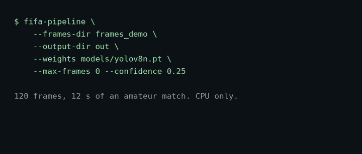

# FIFA Soccer DS analytics



Tracks soccer players in video and builds graphs of their movement, for sports analytics developers.

```bash
pip install git+https://github.com/jayhemnani9910/fifa-soccer-ds
```

[](https://github.com/jayhemnani9910/fifa-soccer-ds/actions/workflows/ci.yml)
[](LICENSE)

Project page: <https://jayhemnani9910.github.io/fifa-soccer-ds/>

It needs Python 3.12. The default install pulls the GPU build of PyTorch, and took 5.5 GB in a clean
container. On a bare Debian or Ubuntu system, OpenCV also needs `apt-get install libgl1 libglib2.0-0`.

## Usage

Cut a video into frames and run the pipeline. Frames have to be JPEGs named `frame_<number>.jpg`.

```bash
mkdir frames
ffmpeg -i match.mp4 -vf fps=10 -start_number 0 frames/frame_%06d.jpg
fifa-pipeline --frames-dir frames --output-dir outputs/run --weights yolov8n.pt --max-frames 0
```

`--max-frames` defaults to 30, and 0 means all of them. Use a new output directory for each run,
since files inside an existing one can be replaced.

You get this in the output directory:

```text
detections/              one JSON per frame
tracks/                  one JSON per frame, with track IDs, boxes and scores
overlays/                one image per frame, with the boxes drawn on
graphs/final_graph.json  graph metadata
pipeline_summary.json    counts and any failures
```

The demo above is a real run, using 12 seconds of an amateur match at 10 fps and the stock
`yolov8n.pt`. It gave 120 frames, 1951 detections, 43 track IDs, and a graph with 372 nodes and 1132
edges. It took 13 seconds on my laptop CPU (i7-11370H). That is one run, not a benchmark.

Look at the 43 before trusting the tracks. No frame in that run had more than 20 tracks, so IDs
break and restart. Stock YOLOv8 also boxes every person, including referees and
people on the sideline.

## How it works

```text
frame directory ─┐
local/live video ├─> YOLO/Ultralytics ─> ByteTrack-style tracker ─> track history
YouTube URL ─────┘             │                                  │
                              └─> detection JSON/overlays          ├─> spatial-temporal graph
                                                                 ├─> optional GNN inference
validated homography + classified teams ──────────────────────────└─> tactical aggregates

FastAPI batch service ─> bounded background task ─> pipeline orchestrator ─> isolated output dir
FastAPI live service  ─> RTSP capture + detector/tracker ─> current detections/health endpoints
```

| Command | What it does |
| --- | --- |
| `fifa-pipeline` | Frame directory or YouTube pipeline (`python -m src.pipeline_full`) |
| `fifa-detect` | Detection on one image or local video (`python -m src.detect.infer`) |
| `fifa-live` | Camera, file or explicitly allowed RTSP input (`python -m src.live.run_live`) |
| `fifa-train-gnn` | GraphSAGE training from a trusted PyG dataset (`python -m src.models.train_gcn`) |
| `src.api.main:app` | Batch YouTube analysis API |
| `src.main:app` | Live stream control API |

## What it does not do

No model weights, datasets, homography calibration or trained GNN checkpoint are tracked in Git. It
is not a trained soccer model or a production service. Accuracy, throughput and GPU behavior on real
footage have not been measured, so check them with your own checkpoint and hardware.

Tracker IDs are not player identities. It does not infer events, passes, touches, PPDA, possession
or named-player stats.

| Area | State | Limit |
| --- | --- | --- |
| Frames to detection, tracking and graph | Implemented, tested with synthetic data and model doubles | Needs a compatible, trusted YOLO checkpoint and real frames |
| Image and video detection CLI | Implemented | Not benchmarked |
| Batch YouTube API | Implemented, with bounded tasks, strict URL checks, download limits and cleanup | Needs network, yt-dlp, FFmpeg and a checkpoint |
| Live file, camera and RTSP | Implemented | No WebRTC or HLS re-streaming. Real RTSP and GPU runs not tested in the audit |
| Tactical pitch control | Implemented behind a flag | Needs a validated homography file and a successful two-team classification |
| GraphSAGE/GCN training and inference | Implemented, unit tested | No trained checkpoint or labeled graph dataset shipped |
| ONNX export | Implemented, with structural checks and an ONNX Runtime load check | Needs a compatible checkpoint. TensorRT needs NVIDIA tooling |
| MLflow and DVC | MLflow is optional. The DVC stage is kept | DVC is not installed by default, see below. No remote configured |
| Weekly retraining | Library code that refuses to run without real loaders and an evaluator | No scheduler or data loader launcher. The default fine-tune trainer does not update weights |
| LoRA fine-tuning (`src/detect`) | Scaffold | Not functional against real Ultralytics |

[AUDIT_REPORT.md](AUDIT_REPORT.md) and [DEPENDENCY_UPGRADE_REPORT.md](DEPENDENCY_UPGRADE_REPORT.md)
hold the evidence and the remaining risks from the July 2026 audit.

## Install details

Linux is what CI and the containers run. Python 3.11 is not supported. FFmpeg is needed for video
and audio work. The CUDA container needs Docker with a compatible NVIDIA runtime.

To work on the code, follow [CONTRIBUTING.md](CONTRIBUTING.md). The optional extras are `audio`,
`data`, `dev`, `export` and `mlops`:

```bash
python -m pip install -e ".[audio,data,dev,export,mlops]"
```

`pyproject.toml` is the source of truth for dependencies, and `requirements.txt` only wraps an
editable dev install. PyTorch, CUDA and ONNX Runtime versions are tied together, so don't upgrade one
alone.

## Models and data

Before a real run:

1. Bring a YOLO checkpoint you trust, with known provenance and license.
2. Bring frames or video you have the right to process.
3. Set `--gnn-weights` only if you have a compatible trained position classifier.
4. Enable tactical analytics only with `--calibration-path` pointing at a validated calibration.

```bash
fifa-pipeline \
  --frames-dir frames \
  --output-dir outputs/calibrated_run \
  --weights /path/to/trusted-yolo.pt \
  --enable-tactical-analytics \
  --calibration-path /path/to/calibration.json
```

PyTorch and PyG files can hold executable pickle payloads. The GNN training CLI therefore requires
`--trust-pickled-dataset`, so use it only on data you made or checked. Ultralytics restricted
checkpoint loading is on by default.

Container runs read the ignored `models/` directory at `/app/models`. Put a reviewed checkpoint at
`models/yolov8n.pt`, or set `APP_YOLO_WEIGHTS` to another mounted path. The host-side `YOLO_WEIGHTS`
setting is separate.

## API

```bash
make run
```

This starts on `127.0.0.1:8000`, with OpenAPI docs at `/docs`. `/ready` returns 503 until
`YOLO_WEIGHTS` points at a checkpoint.

The batch API covers health and readiness, analysis tasks (submit, status, cancel), pipeline info,
system and task metrics as JSON, and tactical results. The live API in `src.main:app` covers stream
start and stop, current detections, checkpoint metadata and health.

Config comes from process environment variables only. There is no dotenv loader, so editing `.env`
does nothing for `make run`. Export the values in your shell, or use the `dev` Compose profile
(`docker compose --profile dev up dev`), the one service that reads `.env`. See
[.env.example](.env.example) for the list.

For anything not on loopback, set both of these. Clients then send `X-API-Key`.

```bash
export API_REQUIRE_KEY=true
export API_KEY='generate-a-long-random-secret-outside-the-repository'
```

Set `CORS_ALLOWED_ORIGINS` explicitly, and leave private RTSP addresses off unless you have a narrow
allowlist. CORS is not authentication. The task store lives in one process and is bounded, so it
won't work for durable multi-worker jobs.

## YouTube and live source limits

- The batch workflow only accepts explicit HTTPS YouTube video hosts and IDs.
- Download size and duration are capped by config.
- Public live APIs reject private and link-local RTSP targets unless you allow them.
- Output names stay under `ANALYSIS_OUTPUT_ROOT`.
- Media and model provenance, retention, privacy and licensing are up to you.

## DVC, MLflow and containers

`dvc.yaml` defines one `analyze_frames` stage from `params.yaml`. It fails on purpose when the frames
or weights are missing. There is no sample-data stage and no DVC remote. `make setup-all` does not
install the DVC CLI, because DVC 3.67.1 pulls DiskCache 5.6.3, whose default pickle deserialization
had an unfixed advisory at the time of the audit. Run DVC in its own environment once that is fixed
or you accept the risk.

MLflow is optional and a tracking failure won't stop a run. Set `MLFLOW_REQUIRED=true` if it should.

Compose exposes the app and the optional MLflow service on loopback only, with read-only, non-root
runtime settings, and has `dev` and `mlops` profiles:

```bash
docker compose config
docker compose up --build app
APP_BUILD_TARGET=mlops APP_MLFLOW_TRACKING_URI=http://mlflow:5000 \
  docker compose --profile mlops up --build app mlflow
docker compose -f docker-compose.yml -f docker-compose.gpu.yml up --build app
```

The last line is the NVIDIA GPU override. It needs the NVIDIA Container Toolkit and a driver that
matches the pinned CUDA image. The base Compose file does not ask for a GPU.

## Layout

```text
src/api/         batch FastAPI app and task lifecycle
src/analytics/   team classification and calibrated tactical calculations
src/calib/       homography and pixel-to-pitch transforms
src/data/        data loading helpers
src/detect/      Ultralytics inference, ONNX/TensorRT export, LoRA scaffold
src/graph/       spatial-temporal graphs and position classifier
src/live/        capture, overlay and live processing
src/models/      GraphSAGE dataset and training
src/track/       tracker runtime and detection-to-track pipeline
src/youtube/     bounded download, metadata and media helpers
tests/           unit, API, integration-style, security and smoke tests
scripts/         data and test video utilities
```

## Contributing and security

See [CONTRIBUTING.md](CONTRIBUTING.md). Report vulnerabilities through [SECURITY.md](SECURITY.md),
not a public issue.

## License and credits

The code is [MIT](LICENSE). It depends on [Ultralytics](https://github.com/ultralytics/ultralytics),
which is AGPL-3.0, so check what that means for you before distributing or hosting this. The MIT
license gives no rights to third-party footage, datasets, model weights or logos.

`docs/demo.gif` is CC BY-SA 4.0, not MIT. It is made from
[a clip of ACBB v. Olympique Adamois](https://commons.wikimedia.org/wiki/File:ACBB_v._Olympique_Adamois_(R%C3%A9gional_2_-_Ligue_Paris-Ile-de-France)_-_12%C3%A8me_journ%C3%A9e_-_Stade_Alphonse_Le_Gallo_(Boulogne-Billancourt,_FR92)_-_11-02-2024_85.webm)
by Manchesterunited1234, trimmed and scaled, with the pipeline's boxes drawn on and terminal cards
added.
